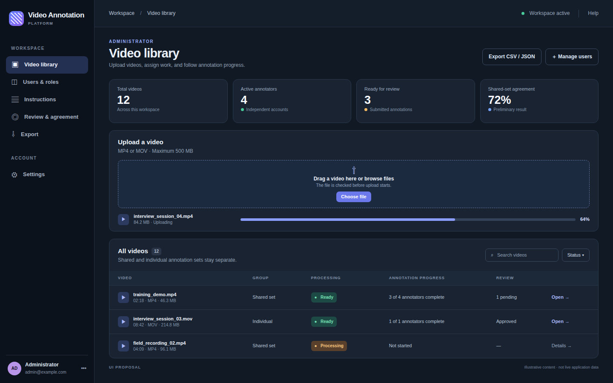
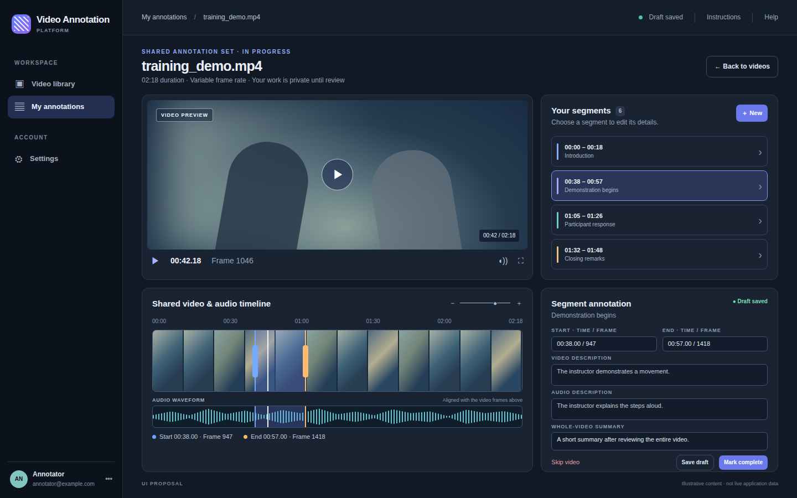

# Administrator and annotator UI proposal

These are single-frame desktop mockups for customer feedback, revised against
the *Multimodal Video Annotation Platform - Project Description and
Specification* (sections 3, 6-8, and 11-13). The example videos, counts,
names, and status values are illustrative. The HTML files are static previews,
not application screens.

## Administrator view

The proposed library keeps upload, transfer progress, processing status, and
annotation progress on one screen. Navigation exposes user and role management,
instructions, review and agreement reporting, and CSV/JSON export. Transfer
progress and background processing are shown separately so that 100% uploaded
does not imply the video is ready.

## Annotator view

The proposed workspace places video playback next to the annotator's own
segment list. Video frames and audio waveform share one timeline and selection.
Start and end values are shown as both timestamps and frame numbers. The
selected segment has separate Video Description and Audio Description fields;
the whole-video Video Summary has its own field. Instructions, draft saving,
skipping, and marking a video complete are visible in the same workspace.

## Questions for customer feedback

1. Is the administrator's upload and progress overview clear enough for daily use?
2. Should users and roles, instructions, review, and export remain in separate sections?
3. Are video, waveform, segment list, and the three annotation fields in the right places?
4. Is it clear that the selected segment uses one shared time/frame interval for both descriptions?
5. Is the distinction between saving a draft and marking a video complete clear?

Search, filters, user management, instructions, review, agreement, export,
waveform, video/audio description fields, whole-video summary, and saved-state
indicators in these pictures are proposals. They are not claims that those
features are implemented. The specification also calls for a reviewer
dashboard; issue #14 asks for administrator and annotator pictures only.
Open `admin.html` or `annotator.html` locally to inspect the static layout at
full size.

The current prototype does not yet show an audio waveform or separate video
and audio description fields, and it does not collect the whole-video summary.
Those are core requirements in the specification, so they need dedicated
implementation work after the layout is agreed.
